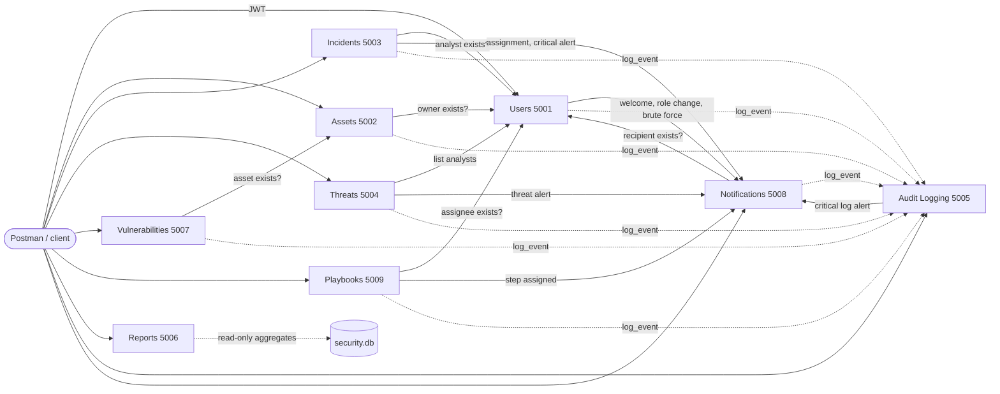

# Security Incident Detection and Response Management System (Sprint 1)

EECE 435L Final Project, American University of Beirut
Team: **Reina Hani**, **Hayam Itani**, **Hamed Bou Saleh**

## Overview

This project is the backend of a security operations platform. A company uses it to register its users and IT assets, report and investigate security incidents, track vulnerabilities and threat indicators, run response playbooks, alert the right people, and keep a tamper-evident audit trail of everything that happens.

The system is split into **9 Flask microservices**. Each service owns one part of the domain, runs on its own port, and talks to the others through REST calls. All services share one SQLite database with real foreign keys, and the same security layer: JWT authentication, role-based access control (RBAC), input validation, field encryption and audit logging.

**Goals of Sprint 1**

- Build all 9 services with full CRUD, search and validation, following the project specification.
- Enforce the four roles (Security Administrator, Security Analyst, Regular Employee, Auditor) on every endpoint.
- Make services cooperate through API calls, for example checking that a user or asset exists, sending notifications and writing audit logs.
- Apply the Lab 2 security measures (SQL injection prevention, encryption, input limits, backups, HTTPS and so on).
- Document and test every endpoint with Postman.

## Table of contents

1. [Services and ownership](#1-services-and-ownership)
2. [Setup and run](#2-setup-and-run)
3. [Testing (Postman and automated tests)](#3-testing-postman-and-automated-tests)
4. [Architecture and service pipeline](#4-architecture-and-service-pipeline)
5. [API reference and permissions](#5-api-reference-and-permissions)
6. [What each service does](#6-what-each-service-does)
7. [Security measures (Lab 2)](#7-security-measures-lab-2)
8. [Project structure](#8-project-structure)
9. [Contributors and workflow](#9-contributors-and-workflow)
10. [Citations and credits](#10-citations-and-credits)

---

## 1. Services and ownership

Each student built three services, and every route starts with that student's name.

| # | Service | Port | Folder | Base path | Student |
|---|---------|------|--------|-----------|---------|
| 1 | Users and Identity Management | 5001 | `user_service/` | `/Reina_Hani/users`, `/Reina_Hani/roles` | Reina Hani |
| 2 | Asset Management | 5002 | `asset_service/` | `/Hamed_Bou_Saleh/assets` | Hamed Bou Saleh |
| 3 | Incident Management | 5003 | `incident_service/` | `/hayam-itani/incidents` | Hayam Itani |
| 4 | Threat Intelligence | 5004 | `threat_service/` | `/hayam-itani/threats` | Hayam Itani |
| 5 | Security Audit Logging | 5005 | `audit_service/` | `/Reina_Hani/logs` | Reina Hani |
| 6 | Security Reports | 5006 | `report_service/` | `/Hamed_Bou_Saleh/reports` | Hamed Bou Saleh |
| 7 | Vulnerability Management | 5007 | `vulnerability_service/` | `/Hamed_Bou_Saleh/vulnerabilities` | Hamed Bou Saleh |
| 8 | Notification and Alert Management | 5008 | `notification_service/` | `/Reina_Hani/notifications` | Reina Hani |
| 9 | Security Playbook and Response Automation | 5009 | `playbook_service/` | `/hayam-itani/playbooks`, `/hayam-itani/actions` | Hayam Itani |

Full endpoint references:

- Users, Audit Logging, Notifications: [`docs/API_DOCUMENTATION.md`](docs/API_DOCUMENTATION.md)
- Incidents, Threat Intelligence, Playbooks: [`docs/API_DOCUMENTATION_Incidents_Threats_Playbooks.md`](docs/API_DOCUMENTATION_Incidents_Threats_Playbooks.md)
- Assets, Vulnerabilities, Reports: [section 5](#assets-vulnerabilities-and-reports-hamed-bou-saleh) of this README and the Postman collection `postman/Hamed_Bou_Saleh_Sprint_1.postman_collection.json`

---

## 2. Setup and run

**Requirements:** Python 3.11 or newer. Everything else is in `requirements.txt` (Flask, PyJWT, bcrypt, cryptography, requests, python-dotenv).

### One-time setup

Windows (PowerShell or CMD):

```powershell
cd 435L--sprint-1
py -m venv venv
venv\Scripts\activate                 # PowerShell may need: Set-ExecutionPolicy -Scope CurrentUser RemoteSigned
pip install -r requirements.txt
python setup_env.py                   # creates .env with random secrets and asks for your full name
python database\init_db.py            # creates database\security.db with all tables
python database\seed.py               # sample users (one per role)
```

macOS / Linux:

```bash
cd 435L--sprint-1
python3 -m venv venv
source venv/bin/activate
pip install -r requirements.txt
python setup_env.py
python database/init_db.py
python database/seed.py
```

`setup_env.py` writes a `.env` file with a random `JWT_SECRET`, `FERNET_KEY`, `HMAC_KEY` and `SERVICE_API_KEY`. The `.env` file is never committed. Your full name goes into `STUDENT_NAME` and is returned in the `X-Student-Name` header of every response.

### Every time

```bash
python run_all.py          # starts all 9 services, Ctrl+C stops them
```

You can also start a single service in its own terminal, for example `python asset_service/app.py` or `python incident_service/app.py`.

Check that everything is up by opening `/health` on each port: http://127.0.0.1:5001/health, then `:5002`, `:5003`, `:5004`, `:5005`, `:5006`, `:5007`, `:5008` and `:5009`.

Always stop the services with Ctrl+C before closing the terminal. Otherwise they keep running in the background and the next start fails because the ports are still in use.

### Sample accounts

Created by `database/seed.py`:

| Username | Password | Role |
|----------|----------|------|
| admin | Admin@12345 | Security Administrator |
| analyst | Analyst@12345 | Security Analyst |
| employee | Employee@12345 | Regular Employee |
| auditor | Auditor@12345 | Auditor |

A second employee is needed to test "own records only" rules. The `register user` request in the Incidents/Threats/Playbooks Postman collection creates `employee2` with the password `Second#Pass2026` (a password may not contain the username).

### Test assets

Incidents and vulnerabilities need an existing asset. With the Asset service running, create them with the **Add asset** request in the Hamed Bou Saleh Postman collection (logged in as admin). If the Asset service is not running, you can insert three test assets directly:

```bash
python -c "from shared.db import get_db; c = get_db(); c.executemany('INSERT INTO assets (asset_name, asset_type, ip_address, operating_system, owner_id, department, location, criticality_level, status) VALUES (?,?,?,?,?,?,?,?,?)', [('Finance laptop 07','Workstation','192.0.2.10','Windows 11',3,'Finance','Beirut HQ','Medium','Active'), ('Mail server','Server','192.0.2.20','Ubuntu 22.04',1,'IT Security','Data centre','High','Active'), ('Customer database','Database','192.0.2.30','PostgreSQL 16',1,'IT Security','Data centre','Critical','Active')]); c.commit()"
```

---

## 3. Testing (Postman and automated tests)

### Postman

Import the collections from the `postman/` folder (Postman → Import):

| Collection | Services | How to use it |
|------------|----------|---------------|
| `Reina- Service 1 users`, `Reina- Service 5 Audit Logging`, `Reina- service 8 notifications` | Users, Audit Logging, Notifications (80 requests) | Each collection holds its base URL as a collection variable (for example `users_url = http://127.0.0.1:5001`), and the requests add `/Reina_Hani` to it. |
| `Sprint1 - Incidents, Threats, and Playbooks (Hayam Itani)` + environment `Sprint1 local (Hayam Itani)` | Incidents, Threat Intelligence, Playbooks (135 requests) | Select the `Sprint1 local` environment. On a fresh database with the three test assets, run the folders in order: Login, Incidents, Threats, Playbooks. Every request has a description and a status-code test. |
| `Hamed_Bou_Saleh_Sprint_1` | Assets, Vulnerabilities, Reports (19 requests, 58 saved example responses) | Run **AUTH → Login Request** first. Its test script saves the JWT into the `{{token}}` collection variable, and every other request uses it as a Bearer token. Log in as admin, analyst or auditor to see the different permissions. |

Together the collections cover every API with success cases, validation errors (400), missing or invalid token (401), wrong role (403), not found (404) and conflicts (409). Each request in the Assets/Vulnerabilities/Reports collection keeps its real responses as saved examples, so the expected output can be checked without running anything.

### Automated tests

With the Users, Audit Logging and Notification services running:

```bash
pip install pytest
python -m pytest tests -v
```

There are 32 end-to-end tests covering every endpoint and role of those three services: validation, encryption in the database, the immutability trigger, tamper detection, brute-force alerts and token revocation.

### Looking at the database

Open `database/security.db` with [DB Browser for SQLite](https://sqlitebrowser.org/). `password_hash` holds a bcrypt hash, and `email_encrypted`, log descriptions and notification messages hold encrypted text. The API returns them decrypted.

---

## 4. Architecture and service pipeline

Every service has the same layers:

```
routes.py      HTTP, input validation, permission check (@require_permission)
   ↓
repository.py  SQL with parameterized queries only
   ↓
models.py      row → object, decryption, to_dict() that never exposes secrets
```

Shared code lives in `shared/`: configuration, database access, security helpers, JWT and RBAC, error responses, and the HTTP clients that services use to call each other.

### How the services talk to each other



- **Audit logging:** every service writes its events by calling `POST /Reina_Hani/logs` (`shared/audit_client.py`).
- **Users:** the notification service calls `GET /Reina_Hani/internal/users/{id}` to check that a recipient exists. The users service calls `POST /Reina_Hani/notifications` for welcome, role change, status change and brute-force alerts.
- **Audit alerts:** the audit service calls `GET /Reina_Hani/internal/users?role=Security Administrator`, then `POST /Reina_Hani/notifications`, to alert every admin about each Critical log.
- **Incidents:** the incident service checks that an incident is assigned to an active Security Analyst (`GET /Reina_Hani/internal/users/{id}`), then sends an Incident Assignment notification. A Critical incident sends a Security Alert to every administrator.
- **Threats:** the threat service calls `GET /Reina_Hani/internal/users?role=Security Analyst` and sends a Threat Alert to every analyst when a High or Critical indicator is added.
- **Playbooks:** the playbook service checks the user a response step is assigned to, then notifies that user.
- **Assets:** the asset service calls `GET /Reina_Hani/internal/users/{id}` to check that the asset owner exists, on create and when the owner changes. If the users service is down it answers 503 instead of saving an unverified owner.
- **Vulnerabilities:** the vulnerability service calls `GET /Hamed_Bou_Saleh/assets/{id}` on the asset service, forwarding the caller's token, before linking a vulnerability to an asset. A missing asset returns 404, and an unreachable asset service returns 503.
- **Reports:** the report service reads the shared tables (users, assets, incidents, threats, vulnerabilities, logs) with read-only aggregate queries.

Service-to-service calls carry an `X-Service-Key` header, which is compared in constant time. `/Reina_Hani/internal/*` endpoints refuse anything else. If a service is down, the caller keeps working and writes the event to its local log file.

### Typical flow

1. An admin logs in (`POST /Reina_Hani/users/login`) and receives a JWT.
2. The admin adds an asset (`POST /Hamed_Bou_Saleh/assets`). The asset service checks the owner with the users service and logs `ASSET_CREATED`.
3. A vulnerability is found on that asset (`POST /Hamed_Bou_Saleh/vulnerabilities`). The vulnerability service checks the asset with the asset service and logs `VULNERABILITY_CREATED`.
4. An employee reports an incident on the asset (`POST /hayam-itani/incidents`). The admin assigns it to an analyst, who gets a notification, and the analyst moves it through its lifecycle.
5. The auditor reviews everything through the logs (`GET /Reina_Hani/logs`) and the reports (`GET /Hamed_Bou_Saleh/reports/summary`).

---

## 5. API reference and permissions

Every protected route uses `@require_permission(...)`, which checks the role against `shared/permissions.py` (permission → role → scope `all` or `own`). A rejected attempt returns `403 {"status":"error","message":"User does not have permission to perform this operation"}` and is stored as an `UNAUTHORIZED_ACCESS` log (Warning). A request with no, invalid or expired token returns 401 and is stored as `UNAUTHENTICATED_ACCESS`.

### Users, Audit Logging, Notifications (Reina Hani)

| API | Admin | Analyst | Employee | Auditor |
|-----|-------|---------|----------|---------|
| POST /Reina_Hani/users/register | Yes, any role | No | Yes (Regular only, also anonymous) | No |
| PUT /Reina_Hani/users/{id} | Yes (+ role, status) | No | own only | No |
| DELETE /Reina_Hani/users/{id} | Yes | No | No | No |
| GET /Reina_Hani/users | Yes | No | No | Yes |
| GET /Reina_Hani/users/{username} | Yes | No | own only | Yes |
| POST /Reina_Hani/logs | Yes | No | No | No |
| GET /Reina_Hani/logs | Yes | No | No | Yes |
| GET /Reina_Hani/logs/{id}, /logs/search | Yes | Yes | No | Yes |
| DELETE /Reina_Hani/logs/{id} | Yes | No | No | No |
| GET /Reina_Hani/logs/user/{id} | Yes | No | No | Yes |
| POST /Reina_Hani/notifications | Yes | No | No | No |
| GET /Reina_Hani/notifications/user/{id}, /{id} | Yes | own | own | Yes |
| PUT /Reina_Hani/notifications/{id}/read | Yes | own | own | No (read-only) |
| GET /Reina_Hani/notifications/search | Yes | own | No | Yes |
| DELETE /Reina_Hani/notifications/{id} | Yes | No | No | No |

### Incidents, Threat Intelligence, Playbooks (Hayam Itani)

| API | Admin | Analyst | Employee | Auditor |
|-----|-------|---------|----------|---------|
| POST /hayam-itani/incidents | Yes | No | Yes | No |
| GET /hayam-itani/incidents, /{id} | Yes | assigned only | reported only | Yes |
| PUT /hayam-itani/incidents/{id}/assign | Yes | No | No | No |
| PUT /hayam-itani/incidents/{id}/status | Yes (only admins close) | assigned only | No | No |
| POST /hayam-itani/incidents/{id}/notes | Yes | assigned only | No | No |
| POST, PUT, DELETE /hayam-itani/threats... | Yes | No | No | No |
| GET /hayam-itani/threats, /{id}, /search | Yes | Yes | No | Yes |
| POST, DELETE /hayam-itani/playbooks... | Yes | No | No | No |
| GET /hayam-itani/playbooks, /{id} | Yes | Yes | No | Yes |
| POST /hayam-itani/playbooks/{id}/actions | Yes | Yes | No | No |
| PUT /hayam-itani/actions/{id}/status | Yes | Yes | No | No |

### Assets, Vulnerabilities and Reports (Hamed Bou Saleh)

| API | Admin | Analyst | Employee | Auditor | Success | Errors |
|-----|-------|---------|----------|---------|---------|--------|
| POST /Hamed_Bou_Saleh/assets | Yes | No | No | No | 201 | 400, 401, 403, 404 owner not found, 503 |
| GET /Hamed_Bou_Saleh/assets | Yes | No | No | Yes | 200 | 401, 403 |
| GET /Hamed_Bou_Saleh/assets/{id} | Yes | Yes | No | Yes | 200 | 400, 401, 403, 404 |
| GET /Hamed_Bou_Saleh/assets/search | Yes | Yes | No | Yes | 200 | 400 unknown parameter, 401, 403 |
| PUT /Hamed_Bou_Saleh/assets/{id} | Yes | No | No | No | 200 | 400, 401, 403, 404 |
| DELETE /Hamed_Bou_Saleh/assets/{id} | Yes | No | No | No | 200 | 401, 403, 404, 409 still referenced |
| POST /Hamed_Bou_Saleh/vulnerabilities | Yes | No | No | No | 201 | 400, 401, 403, 404 asset not found, 503 |
| GET /Hamed_Bou_Saleh/vulnerabilities, /{id} | Yes | Yes | No | Yes | 200 | 400, 401, 403, 404 |
| GET /Hamed_Bou_Saleh/vulnerabilities/search | Yes | Yes | No | Yes | 200 | 400, 401, 403 |
| PUT /Hamed_Bou_Saleh/vulnerabilities/{id} | Yes | Yes | No | No | 200 | 400 invalid transition, 401, 403, 404 |
| DELETE /Hamed_Bou_Saleh/vulnerabilities/{id} | Yes | No | No | No | 200 | 401, 403, 404 |
| GET /Hamed_Bou_Saleh/reports/summary, /incidents, /assets, /threats, /vulnerabilities, /activity | Yes | No | No | Yes | 200 | 401, 403 |

**Search parameters**

- Assets: `name` (partial), `type`, `ip`, `department` (partial), `criticality`, `limit`, `offset`
- Vulnerabilities: `cve`, `severity`, `asset` (asset id), `status`, `limit`, `offset`

Filters are combined with AND, and values are case-insensitive (`?criticality=medium` matches `Medium`). An unknown parameter returns 400. No match returns 200 with an empty list.

**Example: add an asset**

```http
POST http://127.0.0.1:5002/Hamed_Bou_Saleh/assets
Authorization: Bearer <admin token>
Content-Type: application/json

{
  "asset_name": "Web Server Test",
  "asset_type": "Server",
  "ip_address": "10.0.0.5",
  "operating_system": "Ubuntu 22.04",
  "department": "IT",
  "owner_id": 1,
  "location": "Datacenter A",
  "criticality_level": "Low"
}
```

```json
201 Created
{
  "status": "success",
  "message": "Asset created successfully",
  "data": {
    "asset_id": 1,
    "asset_name": "Web Server Test",
    "asset_type": "Server",
    "ip_address": "10.0.0.5",
    "operating_system": "Ubuntu 22.04",
    "owner_id": 1,
    "department": "IT",
    "location": "Datacenter A",
    "criticality_level": "Low",
    "status": "Active",
    "created_at": "2026-10-19 18:04:25"
  }
}
```

**Example: move a vulnerability to the next status**

```http
PUT http://127.0.0.1:5007/Hamed_Bou_Saleh/vulnerabilities/1
Authorization: Bearer <analyst token>
Content-Type: application/json

{ "status": "Under Investigation" }
```

Skipping a step (for example `Open` to `Resolved`) returns `400 Invalid status transition: Open to Resolved. Next allowed status: Under Investigation`.

---

## 6. What each service does

### Users and Identity Management (Reina Hani)

- `POST /Reina_Hani/users/login` checks the username or email and the password with `bcrypt.checkpw`, then returns a JWT signed with `JWT_SECRET` (HS256). The token is valid for 60 minutes and contains the user id, username, role and a unique id (`jti`).
- Every service verifies the signature and expiry, checks the token wasn't revoked (`POST /Reina_Hani/users/logout` stores the `jti` in `revoked_tokens`), and reloads the user from the database. A deleted, suspended or re-roled user is affected immediately.
- Inactive and Suspended users can't log in (403), and their existing tokens stop working.
- Unknown usernames get the same message and the same response time as wrong passwords (a dummy bcrypt check runs), so attackers can't discover valid usernames.
- 5 consecutive failed logins produce a `BRUTE_FORCE_SUSPECTED` Critical log, a Security Alert notification to the user, and a Security Alert to every administrator.

### Asset Management (Hamed Bou Saleh)

- An asset has a name, type (`Server`, `Workstation`, `Database`, `Application`, `Network Device`, `Cloud Resource`), IP address, operating system, owner, department, location, criticality (`Low` to `Critical`) and status (`Active`, `Inactive`, `Under Maintenance`).
- IP addresses are validated with Python's `ipaddress` module (IPv4 and IPv6), so a value like `999.1.1.1` is rejected.
- The owner must be an existing user, checked through the users service.
- Only the name, owner, department, criticality and status can be updated. The type, IP, OS and location are fixed after creation.
- An asset can't be deleted while incidents or vulnerabilities still reference it (409), so no record ever points to a missing asset.
- Name and department search are partial matches, with `%` and `_` escaped so they aren't treated as wildcards.

### Incidents, Threat Intelligence and Playbooks (Hayam Itani)

- **Incident lifecycle:** Open → Under Investigation → Mitigated → Resolved → Closed, one step at a time. Skipping a step or going back returns 400 and is logged as `INVALID_STATUS_TRANSITION`. An incident needs an assigned analyst before it goes Under Investigation, and only an administrator can close it. `resolved_at` is set when it becomes Resolved, and notes can't be added to a closed incident.
- **Own records:** analysts only see and update the incidents assigned to them, and employees only see the incidents they reported.
- **Threat indicators:** the value is checked against its type (IPv4/IPv6 address, domain name, MD5/SHA-1/SHA-256 hash) and normalized to lower case. `UNIQUE (threat_type, threat_value)` prevents duplicates (409). Only the description, severity and source can be updated. Search supports type, value (partial), severity and source (partial), and `%` and `_` in search text are escaped.
- **Playbooks:** response actions are ordered by `step_number`, which is unique per playbook. A step moves Pending → In Progress → Completed, can't start while an earlier step is unfinished, and can't change once completed. Deleting a playbook deletes its actions (`ON DELETE CASCADE`).

### Security Audit Logging (Reina Hani)

- There's no update endpoint, and the `logs_are_immutable` trigger aborts any SQL `UPDATE` on the table.
- When a user is deleted, the foreign key sets `user_id` to NULL (the only change the trigger allows). `original_user_id` and `actor_username` keep the history, so `GET /Reina_Hani/logs/user/{id}` still works.
- Every log carries an HMAC signature, and responses show `"integrity": "verified"` or `"TAMPERED"`.
- Deleting a log (admin only) creates a `LOG_DELETED` log.

### Security Reports (Hamed Bou Saleh)

All reports are read-only, limited to admins and auditors, and include a `generated_at` timestamp.

| Report | Contents |
|--------|----------|
| `/reports/summary` | number of users and assets, open incidents, critical threats, open vulnerabilities |
| `/reports/incidents` | total incidents, counts by severity and by status |
| `/reports/assets` | total assets, critical assets, counts by asset type |
| `/reports/threats` | total threats, counts by severity and type, the 5 most recent indicators |
| `/reports/vulnerabilities` | total vulnerabilities, counts by severity and status, every Critical vulnerability sorted by CVSS score |
| `/reports/activity` | total audit-log entries, login attempts, failed logins, the 5 most performed actions |

Every severity and status is always listed, even when its count is 0, so the reports keep the same shape.

### Vulnerability Management (Hamed Bou Saleh)

- A vulnerability has a title, description, CVE id, CVSS score, severity, affected asset and discovery source, and always starts as `Open`.
- CVE ids must match `CVE-YYYY-NNNN` (4 or more digits at the end), and lower case input is accepted and normalized. CVSS scores must be numbers from 0.0 to 10.0 and are rounded to one decimal.
- The affected asset must exist, checked through the asset service.
- **Lifecycle:** Open → Under Investigation → In Progress → Resolved → Closed, one step at a time. `resolved_at` is filled in automatically when the status becomes Resolved, and it can only be set on Resolved or Closed vulnerabilities.
- Only the description, severity, CVSS score, status and resolution date can be updated.

### Notification and Alert Management (Reina Hani)

- Notifications have a type (Incident Assignment, Security Alert, System Notification, Threat Alert, Vulnerability Alert), a severity and a read status. Messages are encrypted in the database.
- Users see and mark only their own notifications. Admins and auditors can see everyone's.

### Automatically generated logs

`LOGIN_SUCCESS`, `LOGIN_FAILED`, `LOGIN_BLOCKED`, `BRUTE_FORCE_SUSPECTED`, `LOGOUT`, `USER_CREATED`, `ROLE_ASSIGNED`, `USER_UPDATED`, `ROLE_CHANGED`, `ACCOUNT_STATUS_CHANGED`, `USER_DELETED`, `UNAUTHORIZED_ACCESS`, `UNAUTHENTICATED_ACCESS`, `NOTIFICATION_CREATED`, `NOTIFICATION_READ`, `NOTIFICATION_DELETED`, `LOG_DELETED`, `ASSET_CREATED`, `ASSET_UPDATED`, `ASSET_DELETED`, `VULNERABILITY_CREATED`, `VULNERABILITY_UPDATED`, `VULNERABILITY_DELETED`, `INCIDENT_CREATED`, `INCIDENT_ASSIGNED`, `INCIDENT_STATUS_CHANGED`, `INVALID_STATUS_TRANSITION`, `INCIDENT_NOTE_ADDED`, `THREAT_CREATED`, `THREAT_UPDATED`, `THREAT_DELETED`, `PLAYBOOK_CREATED`, `RESPONSE_ACTION_ADDED`, `RESPONSE_ACTION_UPDATED`, `PLAYBOOK_DELETED`.

---

## 7. Security measures (Lab 2)

| Lab 2 item | Implementation |
|------------|----------------|
| 1. Prevent SQL injection | Only parameterized queries (`?`) in every repository. Search filters use fixed column names. Tested with `' OR '1'='1` and `'; DROP TABLE logs; --` |
| 2. Input validation and sanitization | `shared/security.py`: type checks, `strip()`, required fields, unknown fields rejected, email/username regex, allowed-value lists, control characters and `<`/`>` rejected, empty or invalid JSON rejected, 16 KB body limit |
| 3. Encryption of sensitive data | Fernet (cryptography): user emails, audit-log descriptions and notification messages are encrypted in the database. Passwords are bcrypt-hashed (one-way, as the project requires). Keys live in `.env`, not in the code |
| 4. Database file permissions | `chmod 600` is applied to the database and backups on creation (`shared/db.py`). On Windows, also run `icacls database\security.db /inheritance:r /grant:r "%USERNAME%:F"` |
| 5. Limit DB permissions | A trigger forbids `UPDATE` on audit logs, only admins can delete through the API, and each service only writes to its own tables (the report service only reads) |
| 6. Limit input length | Every text field has a max length (name 100, title 150, description 1000 to 2000, message 2000, and so on) |
| 7. Prepared statements | Same as 1: sqlite3 parameter binding |
| 8. Backups | `python backup_db.py` (SQLite online-backup API, keeps the last 10). Automate with Windows Task Scheduler or cron |
| 9. Logging and monitoring | Audit service in the database, plus local rotating files `logs/<service>.log` |
| 10. Exception handling | Global handlers: database errors and crashes return a generic 500 message, and details only go to the log file |
| 11. HTTPS | Run `python generate_cert.py`, then set `USE_HTTPS=true` in `.env`. All services then serve HTTPS and verify each other's certificate |
| 12. Updates | Pinned versions in `requirements.txt`. Update with `pip install --upgrade -r requirements.txt` |

Extra protections:
- an email "blind index" (HMAC-SHA256) so encrypted emails can still be searched
- an HMAC integrity signature on every audit log
- security headers (`X-Content-Type-Options`, `X-Frame-Options`, `Cache-Control: no-store`)
- Flask debug mode off by default
- a password policy: 8+ characters, with an uppercase letter, a lowercase letter, a digit and a special character, and not containing the username

---

## 8. Project structure

```
435L--sprint-1/
├── shared/                     code used by all services
│   ├── config.py               settings and secrets from .env, ports, URLs and route prefixes of every service
│   ├── db.py                   SQLite connection (foreign keys ON), schema creation, chmod 600
│   ├── security.py             bcrypt, Fernet encryption, HMAC, input validation and sanitization
│   ├── auth.py                 JWT tokens, authentication, RBAC decorator, audit of violations
│   ├── permissions.py          RBAC matrix (which role can call which API, ALL or OWN scope)
│   ├── errors.py               uniform {"status": ..., "message": ...} responses
│   ├── app_factory.py          Flask app setup: error handlers, security headers, size limit, logging
│   ├── service_client.py       HTTP client for service-to-service calls (X-Service-Key)
│   ├── audit_client.py         log_event(...)  -> POST /Reina_Hani/logs
│   ├── notification_client.py  notify(...)     -> POST /Reina_Hani/notifications
│   └── user_client.py          get_user(...)   -> GET /Reina_Hani/internal/users/{id}
├── user_service/               Service 1 (Reina Hani)
├── asset_service/              Service 2 (Hamed Bou Saleh): app, routes, repository, models, validators
├── incident_service/           Service 3 (Hayam Itani)
├── threat_service/             Service 4 (Hayam Itani)
├── audit_service/              Service 5 (Reina Hani)
├── report_service/             Service 6 (Hamed Bou Saleh): app, routes, repository
├── vulnerability_service/      Service 7 (Hamed Bou Saleh): app, routes, repository, models, validators, asset_client
├── notification_service/       Service 8 (Reina Hani)
├── playbook_service/           Service 9 (Hayam Itani)
├── database/                   schema.sql (all tables + immutability trigger), init_db.py, seed.py
├── postman/                    Postman collections and environment
├── tests/test_e2e.py           automated end-to-end tests
├── docs/                       API documentation
├── run_all.py                  starts all 9 services
├── setup_env.py                generates .env with random secrets
├── backup_db.py, generate_cert.py
└── requirements.txt, .gitignore
```

---

## 9. Contributors and workflow

| Student | Services | Base path | Postman | Docs |
|---------|----------|-----------|---------|------|
| Reina Hani | 1 Users and Identity, 5 Security Audit Logging, 8 Notifications and Alerts | `/Reina_Hani` | 3 collections (80 requests) | `docs/API_DOCUMENTATION.md` |
| Hayam Itani | 3 Incident Management, 4 Threat Intelligence, 9 Playbooks and Response | `/hayam-itani` | 1 collection + environment (135 requests) | `docs/API_DOCUMENTATION_Incidents_Threats_Playbooks.md` |
| Hamed Bou Saleh | 2 Asset Management, 6 Security Reports, 7 Vulnerability Management | `/Hamed_Bou_Saleh` | 1 collection (19 requests, 58 saved examples) | Section 5 of this README |

Shared work: the `shared/` package, the database schema and the security layer were set up first and are used by all 9 services. Each student registered their own permissions in `shared/permissions.py` and their own ports and route prefix in `shared/config.py`.

**Git workflow:** each student developed on their own branch (`reina-services`, `hayam-services`, `hamed-services`) and merged into `main` through pull requests. Commit messages describe the service and change, so the history shows who built what.

**For teammates adding code**

- All tables are in `database/schema.sql` (one shared database with real foreign keys).
- To log from your service: `from shared.audit_client import log_event`
- To notify (incident assignment, threat or vulnerability alerts): `from shared.notification_client import notify`
- To protect a route: add your permissions to `shared/permissions.py` and use `@require_permission(...)`.
- To put your name in your URLs: pass `url_prefix="/your-name"` to the Blueprint or to `create_app(...)`.

`.gitignore` excludes `.env`, the database, logs, backups and certificates, so secrets never reach GitHub.

---

## 10. Citations and credits

Libraries used (versions pinned in `requirements.txt`):

- [Flask](https://flask.palletsprojects.com/): web framework for all services
- [PyJWT](https://pyjwt.readthedocs.io/): JWT creation and verification
- [bcrypt](https://pypi.org/project/bcrypt/): password hashing
- [cryptography (Fernet)](https://cryptography.io/en/latest/fernet/): field encryption
- [requests](https://requests.readthedocs.io/): service-to-service HTTP calls
- [python-dotenv](https://pypi.org/project/python-dotenv/): loading secrets from `.env`
- Python standard library: `sqlite3`, `ipaddress`, `hmac`, `hashlib`, `logging`

References:

- EECE 435L Final Project specification (services, roles and required endpoints)
- EECE 435L Lab 2 secure-coding recommendations (section 7)
- [CVE identifier format](https://www.cve.org/About/Process) and [CVSS v3.1 specification](https://www.first.org/cvss/v3.1/specification-document) for vulnerability validation
- [SQLite online backup API](https://www.sqlite.org/backup.html) for `backup_db.py`

Evidence: the Postman collections keep real responses for every case as saved examples, and the Sprint 1 report contains the Postman and database screenshots for each endpoint.
